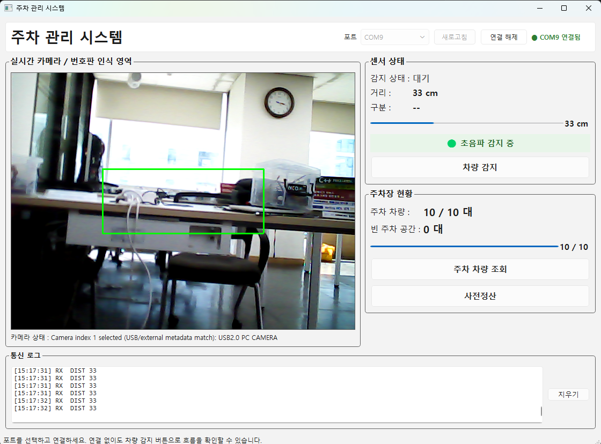
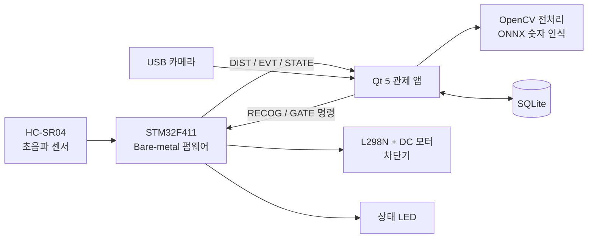
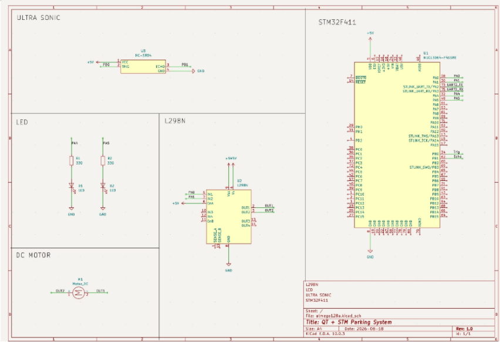
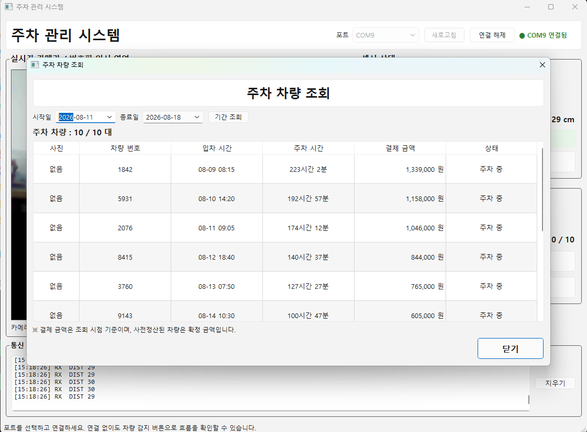
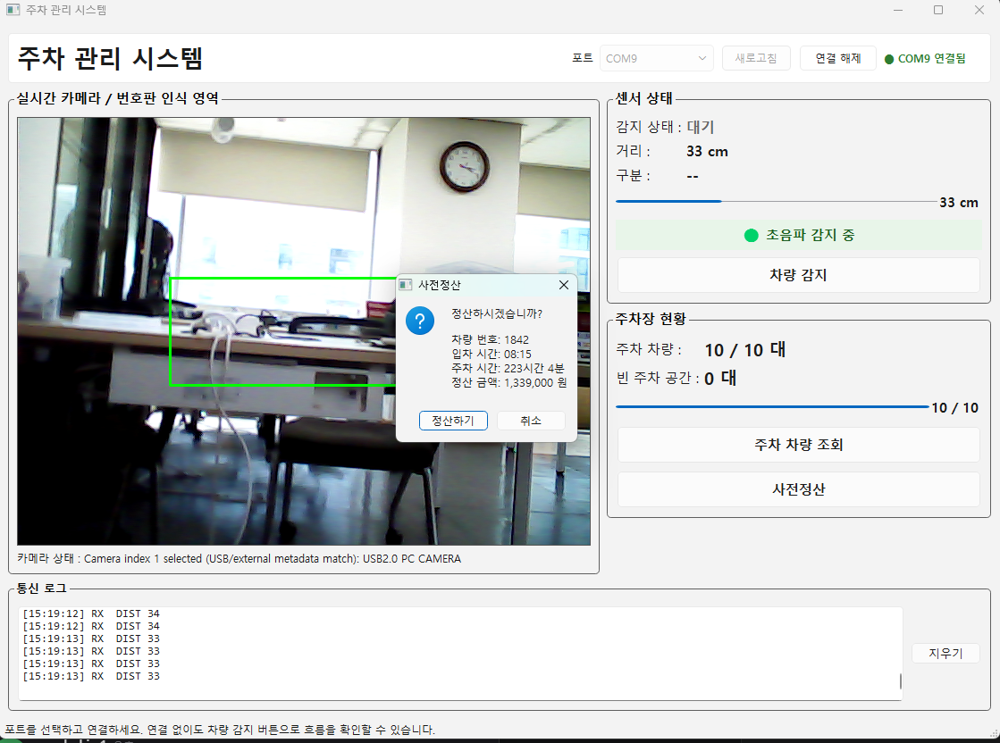

# 차량 감지 기반 스마트 주차 관제 솔루션

> 초음파 센서로 차량을 감지하고, 카메라로 4자리 차량 번호를 인식해 입·출차를 기록한 뒤 차단기를 자동으로 여닫는 주차장 무인 운영 시스템 (4인 팀 프로젝트)

<p align="center">
  
</p>

| 항목 | 내용 |
|---|---|
| 기간 | 2026.08 (대한상공회의소 서울기술교육센터 AI 시스템반도체 SW개발자 과정) |
| 인원 | 4명 · 팀 원본 저장소 [Parking-project-QT/QT-Parking-system](https://github.com/Parking-project-QT/QT-Parking-system) |
| MCU | STM32F411 (Cortex-M4F, 96MHz) · Bare-metal C, 레지스터 직접 제어 (HAL·RTOS 미사용) |
| 호스트 앱 | C++17 · Qt 5 Widgets · Qt SerialPort · Qt Multimedia |
| 영상·추론 | USB 카메라 · OpenCV DNN · ONNX 숫자 분류 모델 |
| 데이터 | SQLite (현재 주차 / 입·출차 이력) |
| 통신 | USART2 115200bps 8N1 · ASCII 라인 프로토콜 |

## 시스템 구성



STM32는 일정 주기로 센서를 읽고 차단기를 안전하게 움직이는 **실시간 제어**를, PC의 Qt 앱은 카메라·인식·DB·GUI 같은 **연산·데이터 처리**를 맡도록 역할을 나눴습니다.

### 회로도

<p align="center">
  
</p>

| 기능 | 핀 | 연결 |
|---|---|---|
| 모터 PWM | PA0 / PA1 (TIM5 CH1·CH2, 20kHz) | L298N IN1 / IN2 |
| 상태 LED | PA4 (빨강) / PA5 (초록) | 330Ω → LED |
| 초음파 TRIG / ECHO | PB0 / PB1 (EXTI1) | HC-SR04 |
| UART | PA2 / PA3 (USART2) | ST-LINK VCP |

## 동작 흐름

1. STM32가 60ms마다 초음파를 측정하고, **10cm 이하가 3회 연속**이면 `EVT DETECT`를 보냅니다.
2. Qt 앱이 카메라 중앙 영역을 캡처해 **4자리 숫자를 인식**합니다.
3. SQLite에서 현재 주차 상태를 조회해 **입차인지 출차인지** 판단합니다.
4. 확인을 누르면 DB를 트랜잭션으로 갱신하고 `GATE OPEN`을 보냅니다.
5. STM32가 차단기를 열고, **차량이 완전히 지나간 것을 확인한 뒤** 닫습니다.

## 핵심 구현

### 1. STM32 Bare-metal 펌웨어

```
인터럽트 ──▶ Handler ──▶ State Manager ──▶ Controller (LED / Motor / US / UART2)
            플래그 확인     상태 변경·지시        기능만 수행 (서로 직접 호출하지 않음)
```

- RCC·GPIO·TIM·EXTI·USART·NVIC 레지스터를 직접 설정했습니다.
- **논블로킹 초음파 측정**: `while(ECHO==0)` 폴링 대신 TIM2(1MHz 프리런)와 EXTI1 인터럽트로 ECHO 폭을 μs 단위로 잽니다. 센서가 응답하지 않아도 메인 루프가 멈추지 않습니다.
- **UART 수신**: RX 인터럽트에서는 32바이트 링 버퍼에 넣기만 하고, 명령 해석은 메인 루프에서 처리해 ISR을 짧게 유지했습니다.
- 시스템 상태(`US_ON → US_OFF → MOTOR`)와 차단기 상태(`IDLE → OPENING → HOLD → WAITING → CLOSING`)를 분리했습니다.

### 2. 차단기 안전 로직 — "모르면 막힌 것으로 본다"

- 진입은 10cm 이하, 이탈은 15cm 이상으로 **임계값을 다르게** 둬서 경계에서 상태가 흔들리지 않게 했습니다.
- 같은 조건이 **3회 연속** 확인되어야 상태를 바꿉니다.
- 차단기를 연 뒤 경로가 20cm보다 멀어진 상태를 3회 확인해야 닫고, 센서 이상에 대비해 **30초 타임아웃** 후 `EVT GATE OBSTRUCTED`를 보고합니다.
- 모터 방향을 바꾸기 전 두 PWM을 먼저 0으로 내려 H-bridge 즉시 역전환을 피했습니다.

### 3. 시리얼 프로토콜 (ASCII, `\n` 종단)

사람이 읽을 수 있는 형식이라 Qt 없이 PuTTY만으로 펌웨어를 단독 디버깅할 수 있습니다.

| 방향 | 메시지 | 의미 |
|---|---|---|
| Qt → STM32 | `PING` / `STATE?` | 연결 확인 / 상태 조회 |
| Qt → STM32 | `RECOG START` / `RECOG CANCEL` | 인식 단계 진입 / 취소 |
| Qt → STM32 | `GATE OPEN` / `MOTOR STOP` | 차단기 시퀀스 시작 / 비상 정지 |
| STM32 → Qt | `DIST <cm>` | 거리 보고 (100ms) |
| STM32 → Qt | `EVT DETECT <cm>` / `EVT CLEAR` | 차량 감지 / 이탈 |
| STM32 → Qt | `EVT GATE DONE` / `EVT GATE OBSTRUCTED` | 차단기 완료 / 경로 막힘 타임아웃 |

### 4. 차량 번호 인식 (OpenCV + ONNX)

- 화면 중앙 300×120 영역에 **그레이스케일 → 가우시안 블러 → Otsu 이진화**를 적용합니다.
- `findContours`로 숫자 후보를 찾아 x 좌표 순으로 정렬하고, 각 숫자를 28×28로 맞춰 **ONNX 모델(MNIST 기반)**로 분류합니다.
- 숫자 4개가 모두 잡힐 때만 결과를 반환하고, 아니면 실패로 처리합니다.
- 영상은 외부 서버로 보내지 않고 관제 PC에서 처리합니다.

### 5. SQLite 입·출차 기록

- `parking`(현재 주차)과 `parking_history`(전체 이력) 두 테이블을 씁니다.
- 입차·출차 시 두 테이블 변경을 **하나의 트랜잭션**으로 묶어, 중간에 실패하면 롤백합니다.
- 앱을 다시 켜면 DB에서 현재 주차 차량을 읽어 점유 수를 복원합니다.

| 기간별 주차 차량 조회 | 사전정산 |
|---|---|
|  |  |

## 결과

| 확인 항목 | 결과 |
|---|---|
| 차단기 동작 (경로 비어 있음) | 약 4.2초에 열림 → 닫힘 완료 |
| 차단기 동작 (장애물 7cm) | 장애물이 있는 동안 열림 유지 |
| 안전 타임아웃 | 초과 시 `EVT GATE OBSTRUCTED` 보고 후 폐쇄 |
| 차량 감지 판정 | 60ms × 3회 연속 확인 (이론상 약 180ms) |
| 펌웨어 크기 | Flash 3,896 B / 512 KiB (약 0.74%), RAM 128 B |
| 실기 연동 | COM 115200bps 거리 로그, 외장 USB 카메라 선택 확인 |

### 시연 영상

- [Qt 관제 앱과 카메라 인식 시연](docs/videos/demo_qt.mp4)
- [STM32 · 초음파 센서 · 차단기 하드웨어 시연](docs/videos/demo_hw.mp4)

## 팀 / 역할

| 구성원 | 담당 내용 |
|---|---|
| 권민지 | 공동 기획, SQLite DB 연동 및 ML 모델 개발 |
| 김선호 | 공동 기획, FSM 설계, USART2 통신 경로 정비, 펌웨어 Handler·상태·protocol 리팩터링 |
| 김승환 | 공동 기획, 초기 STM32·Qt 개발 기반 구성, USB 카메라·DB·ML 통합 및 후속 보완 |
| **이규현** | 공동 기획, 설계 기반 STM32·Qt 주차 시스템의 1차 통합 구현 |

> 역할은 팀 원본 저장소 README 기준입니다.

## 트러블슈팅

- **모터가 안 돌던 문제** — 최대 듀티로 10초 구동해도 보드는 정상인 것을 먼저 확인해 소프트웨어 원인을 배제했고, L298N `ENA` 점퍼 미장착이라는 하드웨어 원인을 빠르게 찾았습니다.
- **차단기 진행창이 닫히지 않던 문제** — `QSerialPort::readyRead` 핸들러 안에서 완료 신호를 기다려, 신호가 들어올 경로를 스스로 막고 있었습니다. `QTimer::singleShot(0, ...)`으로 처리를 다음 이벤트 루프로 넘겨 해결했습니다.
- **타임아웃 불일치** — Qt 타임아웃(15초)과 펌웨어 최악 소요 시간(34초)을 따로 관리하다 어긋났습니다. Qt 값을 펌웨어 상수에서 계산하도록 바꿔 자동으로 맞춰지게 했습니다.

## 한계

- 실제 자동차 번호판 전체가 아니라, 정해진 영역 안의 **4자리 숫자**를 인식하는 단계입니다. 인식률을 정량 평가한 자료는 없습니다.
- 차단기는 DC 모터 기반 축소 모형입니다.

## 폴더 구조

```
Parking_System/
├── firmware/            STM32F411 Bare-metal 펌웨어 (Handler / State Manager / Controller)
├── qt-parking/          Qt 5 관제 앱 (카메라·인식·DB·시리얼)
│   └── model/           mnist_model.onnx
├── docs/images, videos  README 사진 · 시연 영상
└── Makefile             펌웨어 + Qt 앱 통합 빌드
```
